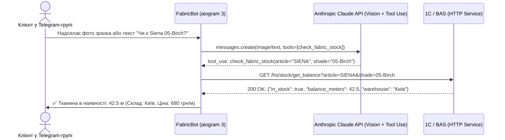

# FabricBot AI — Інтелектуальний Telegram-бот для обліку текстилю та штор (Claude API + 1C ERP)

[](https://www.python.org/)
[](https://docs.aiogram.dev/)
[](https://docs.anthropic.com/)
[](LICENSE)

Комерційний асинхронний Telegram-бот для автоматизації відповідей про наявність тканин, штор та фурнітури у клієнтських групах без залучення менеджерів. Бот інтегрує мультимодальний комп'ютерний зір (**Anthropic Claude 3.5 Sonnet Vision**), функціональні виклики (**Tool Use**) та пряму синхронізацію з обліковою системою **1С:Підприємство / BAS ERP**.

---

## 🌟 Основні можливості

- **Автономне розпізнавання запитів у групах:** Бот слухає повідомлення без необхідності прямого тегування `@bot`, самостійно виділяючи питання клієнтів про тканини.
- **Розпізнавання фотографій зразків (Claude 3.5 Vision):** Клієнт може надіслати фото рулону з етикеткою або каталожної картки — AI витягує артикул та відтінок (наприклад, `SIENA 05-Birch`, `Florence 02-Ivory`).
- **Механізм Tool Use / Function Calling:** AI повертає валідовані параметри пошуку в структурованому форматі JSON.
- **HTTP-сервіс 1C:Підприємство / BAS:** Асинхронний запит до ендпоінту облікової бази для отримання актуальних залишків у метрах, складів розташування та актуальних цін.
- **Локальний кеш та оптимізація токенів:** Зменшення витрат на виклики LLM завдяки валідації та кешуванню регулярних запитів.

---

## 🏗 Архітектурна схема



---

## 🛠 Технологічний стек

- **Core:** Python 3.12, `asyncio`
- **Telegram Bot Framework:** `aiogram 3.x`
- **AI Engine:** `anthropic` Python SDK (Claude 3.5 Sonnet)
- **ERP Integration:** `aiohttp` (асинхронний клієнт з таймаутами та Basic Auth)
- **Config & Validation:** `pydantic-settings`, `python-dotenv`

---

## 🚀 Швидкий запуск

### 1. Клонування репозиторію
```bash
git clone https://github.com/lesson4050-blip/FabricBot_AI.git
cd FabricBot_AI
```

### 2. Встановлення залежностей
```bash
python -m venv .venv
source .venv/bin/activate  # Для Windows: .venv\Scripts\activate
pip install -r requirements.txt
```

### 3. Конфігурація середовища
Скопіюйте приклад конфігурації:
```bash
cp .env.example .env
```
Заповніть ваші ключі у файлі `.env`:
- `TELEGRAM_BOT_TOKEN`
- `ANTHROPIC_API_KEY`
- `ERP_1C_BASE_URL`

### 4. Запуск бота локально
```bash
python main.py
```

### 5. Запуск через Docker Compose (Production)
```bash
docker compose up --build -d
docker compose logs -f
```

---

## 📄 Ліцензія
Проєкт ліцензовано за стандартом [MIT License](LICENSE).
